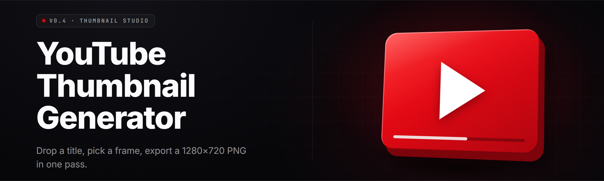

  
  
  

  

  
  

---

**Stop guessing why your thumbnails flatline. Generate scroll-stopping YouTube thumbnails — batch, AI-assisted, retention-scored — right on your desktop.**

A 2026 Windows desktop app for creators who film for the algorithm and thumbnail for the CTR. Feed it the video, feed it the niche, walk away with 12 variants ranked by predicted click-through.

---

## 🎬 Tips for Best Results

- Pair the AI caption pass with a **manual face crop** — faces beat text-only in almost every A/B test.
- Keep contrast ratios above **4.8:1** between headline text and background; the Studio flags anything below.
- Load 3–5 **competitor thumbnails from the same search term** into the Reference Tray before generating — the palette engine calibrates to the shelf.
- Export at **1280×720** and under **2 MB** — YouTube re-compresses silently above that.
- Run the **CTR Predictor** *after* the brightness pass, not before — it scores final pixels, not draft layers.

---

## 📺 Overview

| Category | Details |
|---|---|
| Product type | Desktop thumbnail generator (.exe, portable) |
| Primary user | YouTube creators, editors, thumbnail freelancers |
| Core engine | Local diffusion + template compositor + CTR scorer |
| Output formats | PNG, JPG, WebP @ 1280×720 (YouTube native) |
| Batch size | Up to 40 variants per session |
| AI assist | On-device caption, face detect, palette match, retention score |
| Data footprint | ~412 MB installed, no cloud upload by default |

The Studio splits thumbnail work into three lanes — **Compose**, **Generate**, and **Score** — so you can push a rough draft through in ninety seconds or grind forty variants to find the 0.4% outlier that doubles your CTR. Everything runs locally. Nothing phones home unless you flip the optional cloud-render toggle for the heavy diffusion pass.

---

## 🖼️ What is youtube-thumbnail-studio

| Term | Explanation |
|---|---|
| CTR Predictor | A local model scoring each variant against a niche-trained click-through dataset. |
| Face Snap | Auto-detects faces and snaps them to the rule-of-thirds hot zones. |
| Shelf Match | Compares your variant's palette to top-ranking thumbnails for a target keyword. |
| Template Layer | A reusable .ytl file holding text boxes, gradients, and brand colors. |
| Retention Curve | Estimated watch-time falloff given the visual hook strength. |
| Batch Rack | A queue of 1–40 variants pushed through the pipeline at once. |
| Safe Frame | The area YouTube won't crop on mobile — Studio gates content to it. |

- Keeps you from eyeballing thumbnails one at a time like it's 2014.
- Surfaces the CTR outliers you'd never notice in a 12-up grid.
- Locks brand colors and fonts so a channel stays visually consistent.
- Runs offline — nothing about your unreleased video leaves the machine.
- Slashes iteration time from "an afternoon" to "a coffee refill."

---

## 🧠 The Problem

- You spend six hours editing and ninety seconds on the thumbnail — and it shows in your CTR.
- You know the *vibe* you want but the composite tools are built for photographers, not creators.
- The "best" thumbnail is invisible until it's live, and by then the algorithm has moved on.
- Free AI tools hallucinate text into your face, garble the headline, and output 1024×1024 crops that YouTube mangles.
- Massive channels A/B test 14 variants; you A/B test **one** and pray.
- Mobile-first viewers see a thumbnail at 1/8 scale — your beautiful 36pt caption is a smudge.
- Nothing on the shelf actually tells you *why* variant 7 beat variant 3.

---

## 🎯 The Solution

| Problem | Solution |
|---|---|
| Slow iteration | Batch Rack pushes 40 variants through Compose → Generate → Score in one pass. |
| Broken AI tools | On-device captioner keeps text legible, sharp, and inside the Safe Frame. |
| Mobile smudge | Studio renders every variant at 1280×720 **and** a 320px mobile preview. |
| No feedback loop | CTR Predictor scores each variant and shows the delta between top and bottom. |
| Brand drift | Templates (.ytl) lock palette, fonts, and layout per channel. |
| Guessing what wins | Shelf Match compares your palette to the top 20 for a target keyword. |
| Opaque results | Every score carries a factor breakdown — contrast, subject, text density, hook. |

---

## 📦 Quick Start

1. 🖱️ Visit the project page on GitHub and grab the latest `youtube-thumbnail-studio` build from the download section.
2. 📂 Right-click the archive → **Extract All** → pick a folder (avoid Program Files; the app writes scratch files next to itself).
3. 🚀 Double-click the `.exe` inside the extracted folder. Windows SmartScreen may prompt once — **More info → Run anyway**.
4. 🎨 Drop your source image or record your face, pick a **Template**, and hit **Compose**.
5. 📊 When the Batch Rack finishes, sort by **Predicted CTR** and export the top three.

---

## 🧩 Key Features

| Feature | Description | Benefit |
|---|---|---|
| Batch Rack | Queue 1–40 variants in one pass | Never ship a single-shot guess again |
| CTR Predictor | Local model scores each variant | Pick by data, not gut |
| Face Snap | Auto face detection + thirds alignment | Faces land where eyes look |
| Shelf Match | Palette compare vs top-ranked rivals | Instant "does this fit the shelf?" |
| Headline Engine | Auto-sizes text to the Safe Frame | No more cut-off captions |
| Brand Templates (.ytl) | Save palette + fonts + boxes | Channel visual consistency in one click |
| Mobile Preview | Live 320px render pane | Catch smudges before upload |
| Contrast Guard | Warns below 4.8:1 text/background | Legibility across devices |
| Export Presets | 1280×720 PNG < 2 MB | No YouTube re-compression surprises |
| Layer History | Full undo stack per project | Iterate without fear |
| Keyword Tray | Attach target search terms per project | Shelf Match + CTR feed off it |
| Offline Mode | All inference local | Unreleased video never leaves the box |

---

  

---

## 🏗️ Installation

1. **Download the build.** Head to the project page, hit the download section, grab the latest archive. The file is a portable archive — no installer, no registry writes.
2. **Extract it.** Right-click → *Extract All*. Pick a folder with at least **1 GB free** (the app caches model weights on first run). Don't put it on a network drive — the scratch writer is chatty.
3. **Run the `.exe`.** Inside the extracted folder, double-click the `.exe`. First launch deploys the local model cache (~180 MB) and writes `.ytl` templates to a `templates/` subfolder. Subsequent launches take under two seconds.

No Python. No Node. No `git clone`. Nothing to compile. Extract → run.

---

## ⚖️ Comparison

| Aspect | Generic Image Editor | Browser AI Tools | youtube-thumbnail-studio |
|---|---|---|---|
| Designed for YouTube | No | Partially | Yes — native 1280×720 + Safe Frame |
| Batch generation | No | No | Up to 40 variants per rack |
| CTR feedback | None | None | Local predictor with factor breakdown |
| Rival palette matching | Manual | None | Shelf Match against top-20 keyword |
| Mobile preview | Manual resize | Sometimes | Always-on 320px pane |
| Works offline | Yes | No (cloud calls) | Yes — all inference local |
| Template reuse | Manual | No | `.ytl` files, per-channel |
| Setup time | Install 300 MB | Sign-in + quota | Extract → run → done |

---

## 📱 Compatibility

| Platform | Support | Notes |
|---|---|---|
| Windows 10 (64-bit) | ✅ Tested | Build 1903+, DX11 GPU recommended |
| Windows 11 (64-bit) | ✅ Tested | Primary target |
| Windows on ARM | ⚠️ Partial | Runs, slower CPU inference |
| macOS | ❌ Not supported | Roadmap only |
| Linux (Wine) | ⚠️ Community | No official support |

---

## 🧪 All Modules Status

| Module | Status | Description |
|---|---|---|
| Batch Rack | ✅ Working | Queues 1–40 variants through the full pipeline |
| Compose Lane | ✅ Working | Layer editor with text, image, gradient, brand lock |
| Generate Lane | ✅ Working | Local diffusion for background + subject styling |
| Score Lane | ✅ Working | CTR Predictor + factor breakdown per variant |
| Shelf Match | ✅ Working | Palette comparison against top-20 for keyword |
| Face Snap | ✅ Working | Face detection + rule-of-thirds alignment |
| Headline Engine | ✅ Working | Auto text scaling to Safe Frame bounds |
| Contrast Guard | ✅ Working | Live 4.8:1 legibility warnings |
| Mobile Preview | ✅ Working | 320px render pane, updated on every edit |
| Template Engine | ✅ Working | `.ytl` save/load per channel |
| Keyword Tray | ✅ Working | Attach search terms; feeds Shelf + CTR |
| Export Presets | ✅ Working | PNG / JPG / WebP, 1280×720, <2 MB target |
| Layer History | ✅ Working | Full undo stack, per-project |
| Reference Tray | ✅ Working | Load rival thumbnails for palette calibration |
| Face Kit Library | ✅ Working | 40+ preset expression/pose guides |
| Batch Naming | ✅ Working | Auto-rename variants by score and rank |
| Retention Overlay | ✅ Working | Shows estimated watch-time given hook strength |
| Color Science Pass | ✅ Working | Studio-grade contrast/level tune |
| Text Stroke Engine | ✅ Working | Outline/glow for shelf readability |
| Project Autosave | ✅ Working | Crash-safe scratch writes every 30s |
| Cloud Render (optional) | ⚠️ Beta | Off-machine diffusion pass, off by default |
| Telemetry | ✅ Working | Local-only, off by default, you can wipe it |

---

## 🧷 Known Issues

| Issue | Solution |
|---|---|
| First launch slow (>30s) | It's deploying the local model cache. Subsequent launches are <2s. |
| SmartScreen warning on launch | Right-click the `.exe` → Properties → Unblock, or **More info → Run anyway**. |
| Batch stalls on variant 20+ | Reduce diffusion steps in Settings → Generate → Quality. |
| Templates not saving | Confirm the folder isn't read-only (avoid Program Files installs). |
| Shelf Match returns empty | Keyword Tray needs at least one term; save the project after adding. |
| Mobile Preview looks blurry | That's the point — it simulates the mobile render. Zoom out to judge at true scale. |

---

## 🔥 Hotkeys

| Shortcut | Action |
|---|---|
| `Ctrl + N` | New project |
| `Ctrl + O` | Open `.ytl` template |
| `Ctrl + B` | Push current draft to Batch Rack |
| `Ctrl + G` | Run Generate Lane on the selected layer |
| `Ctrl + K` | Fire CTR Predictor on all variants |
| `Ctrl + M` | Toggle Mobile Preview pane |
| `Ctrl + E` | Export top-ranked variant |
| `F5` | Refresh Shelf Match against Keyword Tray |

---

## ✅ Usage Guidelines

| Allowed | Not allowed |
|---|---|
| Generating thumbnails for your own YouTube channel | Bulk-generating thumbnails to harass a specific creator |
| A/B testing variants on your uploaded videos | Faking CTR signals to manipulate YouTube analytics |
| Building templates for clients you edit for | Reselling the app's bundled diffusion weights |
| Loading public rival thumbnails into the Reference Tray | Training your own model on scraped creator thumbnails |

---

## 📚 Table of Contents

- [Tips for Best Results](#-tips-for-best-results)
- [Overview](#-overview)
- [What is youtube-thumbnail-studio](#️-what-is-youtube-thumbnail-studio)
- [The Problem](#-the-problem)
- [The Solution](#-the-solution)
- [Quick Start](#-quick-start)
- [Key Features](#-key-features)
- [Installation](#️-installation)
- [Comparison](#️-comparison)
- [Compatibility](#-compatibility)
- [All Modules Status](#-all-modules-status)
- [Known Issues](#-known-issues)
- [Hotkeys](#-hotkeys)
- [Usage Guidelines](#-usage-guidelines)
- [FAQ](#-faq)

---

## ❓ FAQ

1. **Does this upload anything to the cloud?**
   No. The Studio's inference, prediction, and shelf matching all run locally. The only network call is the optional Cloud Render toggle in Settings, which is off by default and clearly labeled.

2. **What does the `.exe` need to run?**
   Windows 10 (build 1903+) or Windows 11, 64-bit. A DX11-capable GPU is recommended for the Generate Lane; CPU-only mode works but is slower.

3. **Can I bring my own fonts?**
   Yes. Drop `.ttf` or `.otf` files into the `fonts/` subfolder next to the `.exe`. The Headline Engine picks them up and the Contrast Guard tests legibility on each.

4. **How accurate is the CTR Predictor?**
   It's a directional score, not a guarantee. It's trained on thumbnail-level click data and ranks variants against each other well; treat the delta between top and bottom variants as the useful signal.

5. **Will the output fit YouTube's limits?**
   Every preset exports at 1280×720. The Export panel shows the file size live and warns if you're above 2 MB, which is where YouTube starts re-compressing aggressively.

6. **Can I use this for client work?**
   Yes. Templates (.ytl) are portable — hand a client a template and their editor can load the same palette, fonts, and layout.

7. **Does it work with Shorts thumbnails?**
   Shorts don't use custom thumbnails, but you can export at 1080×1920 using the Vertical preset for cross-post thumbnails on other platforms.

8. **Where are my projects saved?**
   In a `projects/` folder next to the `.exe`. Portable — copy the whole folder to another machine and everything travels with it.

9. **Why does variant 12 sometimes score higher than variant 1?**
   Variants are generated independently; rank comes from the CTR Predictor, not generation order. Sort the Batch Rack by **Predicted CTR** to see the real ranking.

10. **Can I disable the AI lanes entirely?**
    Yes. Settings → Lanes lets you disable Generate, CTR Predictor, and Shelf Match. You're left with a fast template compositor.

---

  

---

The 2026 shelf is crowded and the algorithm is indifferent — but the delta between a 3% CTR and a 6% CTR is a *thumbnail*, not a re-edit. The Studio hands you forty candidates, a score, and a reason. Take the top three, ship the video, and let the A/B tell you what the shelf actually wanted.
